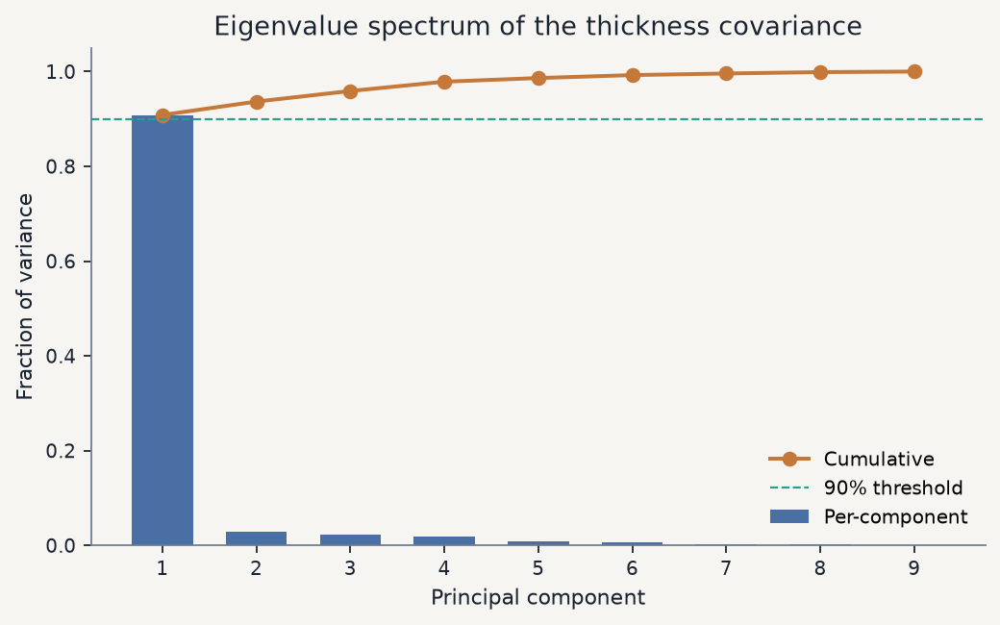

# Silicon Wafer Thickness Modes via Principal Component Analysis

In-line metrology of polished silicon wafers records thickness deviations at
nine spatially distributed gauge groups. Because those gauges sample the same
continuum thickness field, their readings are strongly correlated, and the
effective degrees of freedom of the wafer geometry are far fewer than nine.
This repository recovers those degrees of freedom by constructing the sample
covariance of the standardized gauges and diagonalizing it: the leading
eigenmodes are the dominant spatial patterns of thickness variation, and the
associated eigenvalues quantify how much of the metrology signal each pattern
carries.

## Physical problem

A wafer section is described by the nine-dimensional observation

$$
\mathbf{x}_i = \bigl(G_1^{(i)},\, G_2^{(i)},\, \ldots,\, G_9^{(i)}\bigr)^{\mathsf{T}},
\qquad i = 1,\ldots,n,
$$

where each $G_j$ is a thickness deviation from the manufacturing target at
gauge group $j$, and $n = 184$ sections are available. Manufacturing control
asks two related questions:

1. How many independent geometric modes are actually present in the thickness
   field?
2. Which gauges carry redundant information about those modes?

Principal component analysis answers both by replacing the correlated gauge
basis with an orthonormal eigenbasis of the thickness covariance.

## Data and exploratory structure

The raw table lives in [`data/silicon_wafer_thickness.csv`](data/silicon_wafer_thickness.csv).
Each column is one gauge; each row is one section index. The nine traces
already reveal a shared global envelope punctuated by localized excursions:


*Figure 1. Overlay of the nine gauge traces. Coherent peaks and troughs across
sensors indicate a dominant common-mode thickness fluctuation; isolated
spikes mark spatially localized deviations.*

The Pearson correlation matrix confirms that nearly every gauge pair is
positively correlated, often above $0.9$:


*Figure 2. Sensor–sensor correlation. High off-diagonal entries show that the
nine gauges do not behave as independent observables; they are projections of
a lower-dimensional thickness field.*

## Mathematical formulation

### Standardization

To prevent gauges with larger metrology variance from dominating the spectrum,
each column is standardized to zero mean and unit sample variance:

$$
X_{ij}
=
\frac{(X_{\mathrm{raw}})_{ij} - \mu_j}{\sigma_j},
\qquad
\mu_j = \frac{1}{n}\sum_{i=1}^{n}(X_{\mathrm{raw}})_{ij},
\qquad
\sigma_j^{2}
=
\frac{1}{n-1}\sum_{i=1}^{n}\bigl((X_{\mathrm{raw}})_{ij}-\mu_j\bigr)^{2}.
$$

### Covariance eigenproblem

With $X \in \mathbb{R}^{n \times 9}$ the standardized data matrix, the
unbiased sample covariance is

$$
C = \frac{1}{n-1}\, X^{\mathsf{T}} X.
$$

The principal modes are the solutions of the symmetric eigenproblem

$$
C\, v_k = \lambda_k\, v_k,
\qquad
\lambda_1 \ge \lambda_2 \ge \cdots \ge \lambda_9 \ge 0,
$$

where $v_k \in \mathbb{R}^{9}$ are orthonormal **loadings** and $\lambda_k$
are the variances along those directions. The explained-variance fraction of
component $k$ is

$$
\rho_k = \frac{\lambda_k}{\sum_{m=1}^{9} \lambda_m}.
$$

Scores (coordinates of each wafer section in the eigenbasis) and truncated
reconstructions follow as

$$
T = X V_r,
\qquad
\hat{X} = T V_r^{\mathsf{T}} = X V_r V_r^{\mathsf{T}},
\qquad
V_r = [v_1\,\cdots\,v_r].
$$

A fuller derivation is collected in [`docs/methodology.md`](docs/methodology.md).

## Eigenvalue spectrum

Diagonalizing $C$ yields a steeply decaying spectrum: the first eigenvalue
alone accounts for approximately **90.8%** of the total standardized variance;
the first two together reach **93.7%**.



*Figure 3. Eigenvalue spectrum of the thickness covariance. The sharp drop
after PC1 shows that wafer geometry is dominated by a single common-mode
fluctuation; PC2 and higher capture progressively finer spatial structure.
The cumulative curve crosses 90% already at the first component.*

## Leading thickness modes

Projecting every section onto $(v_1, v_2)$ collapses the nine-dimensional
metrology vector onto a plane that retains most of the signal:


*Figure 4. Scores of the 184 wafer sections in the leading principal plane.
Spread along PC1 reflects the amplitude of the global thickness offset; the
weaker PC2 axis isolates residual spatial asymmetry.*

The loadings themselves identify the physical character of each mode:


*Figure 5. Gauge groups as points in loading space. Sensors that sit close
together weight the retained modes similarly and are therefore
metrologically redundant for those modes.*


*Figure 6. Loading weights by gauge. PC1 loadings are uniformly positive and
nearly equal ($\approx 0.34$), identifying a **global thickness offset**.
PC2 flips sign: gauges $G_1$–$G_5$ enter with negative weight while $G_6$
(and, to a lesser extent, $G_7$–$G_9$) enter positively, identifying a
**spatial contrast / gradient mode** across the wafer.*

Quantitatively, the closest pair in the PC1–PC2 loading plane is **G1–G5**
(Euclidean distance $\approx 0.023$). Those two gauges contribute almost
indistinguishably to the retained thickness modes and are natural candidates
for sensor consolidation if the metrology budget must be reduced.

## Reconstruction fidelity

Truncating the expansion to $r$ components and measuring the
root-mean-square error of $\hat{X}$ against $X$ confirms that two modes
already recover the standardized thickness field to an RMSE of about $0.25$:


*Figure 7. Reconstruction error versus model order. The steep initial drop
mirrors the scree plot: once the global offset (PC1) and the leading spatial
contrast (PC2) are kept, additional components buy only marginal fidelity.*

## Repository layout

```
data/                  silicon wafer thickness table
src/wafer_pca/         reusable analysis package
  data.py              loading and z-score standardization
  pca.py               covariance eigendecomposition PCA
  exploration.py       correlation and reconstruction diagnostics
  plotting.py          figure generation for the workflow above
scripts/run_analysis.py  end-to-end pipeline → figures/
docs/methodology.md    extended mathematical notes
tests/                 invariants of standardization and PCA
figures/               plots embedded in this README
```

## Running the analysis

```bash
python -m venv .venv
source .venv/bin/activate
pip install -r requirements.txt

PYTHONPATH=src python scripts/run_analysis.py
PYTHONPATH=src python -m pytest
```

The pipeline regenerates every figure under `figures/` and writes a numerical
summary to `figures/analysis_summary.json`.

## Key quantitative results

| Quantity | Value |
| --- | --- |
| Sections $\times$ gauges | $184 \times 9$ |
| Variance in PC1 | $90.8\%$ |
| Variance in PC1 + PC2 | $93.7\%$ |
| Closest gauges (loading plane) | G1–G5 |
| RMSE with $r = 2$ components | $0.25$ (standardized units) |

In short: silicon wafer thickness, as seen by nine correlated gauges, is
essentially a **one-to-two-mode geometric field**. The first principal
component is a global offset shared by every sensor; the second encodes the
leading spatial gradient. Higher components refine the reconstruction but do
not change the physical picture.
