# Silicon Wafer Thickness Modes via Principal Component Analysis

In-line metrology of polished silicon wafers records thickness deviations at
nine spatially distributed gauge groups. Because those gauges sample the same
continuum thickness field, their readings are strongly correlated, and the
effective degrees of freedom of the wafer geometry are far fewer than nine.
This repository recovers those degrees of freedom by constructing the sample
covariance of the standardized gauges and diagonalizing it: the leading
eigenmodes are the dominant spatial patterns of thickness variation, and the
associated eigenvalues quantify how much of the metrology signal each pattern
carries.

## What a gauge is

In this setting a **gauge** (columns `G1`…`G9`) is a thickness metrology
sensor — or a small group of co-located probes — that reports how far the
local wafer thickness sits from the manufacturing target. A reading of $0$
means on-spec; positive / negative values mean locally thick / thin. The nine
gauges are not nine different physical quantities: they are nine spatial
samples of one continuous thickness field on the wafer. That shared field is
why their signals move together, and why a handful of principal modes can
replace the full nine-dimensional vector.

## Physical problem

A wafer section is described by the nine-dimensional observation

$$\mathbf{x}_i = \bigl(G_1^{(i)},\, G_2^{(i)},\, \ldots,\, G_9^{(i)}\bigr)^{\mathsf{T}}, \qquad i = 1,\ldots,n,$$

where each $G_j$ is the thickness deviation recorded by gauge $j$, and
$n = 184$ sections are available. Manufacturing control asks two related
questions:

1. How many independent geometric modes are actually present in the thickness
   field?
2. Which gauges carry redundant information about those modes?

Principal component analysis answers both by replacing the correlated gauge
basis with an orthonormal eigenbasis of the thickness covariance.

## Data and exploratory structure

The raw table lives in [`data/silicon_wafer_thickness.csv`](data/silicon_wafer_thickness.csv)
(see [`data/README.md`](data/README.md) for provenance and units). Each column
is one gauge; each row is one section index. The nine traces already reveal a
shared global envelope punctuated by localized excursions:

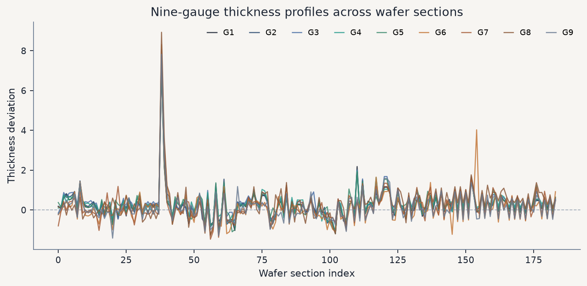

*Figure 1. Overlay of the nine gauge traces. Coherent peaks and troughs across
sensors indicate a dominant common-mode thickness fluctuation; isolated
spikes mark spatially localized deviations that motivate the outlier analysis
below.*

The Pearson correlation matrix confirms that nearly every gauge pair is
positively correlated, often above $0.9$:

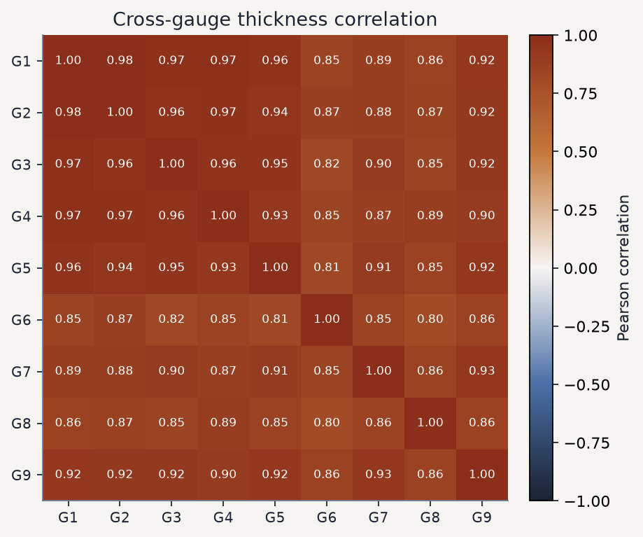

*Figure 2. Sensor–sensor correlation. High off-diagonal entries show that the
nine gauges do not behave as independent observables; they are projections of
a lower-dimensional thickness field.*

## Mathematical formulation

### Standardization

To prevent gauges with larger metrology variance from dominating the spectrum,
each column is standardized to zero mean and unit sample variance:

$$X_{ij} = \frac{(X_{\mathrm{raw}})_{ij} - \mu_j}{\sigma_j}, \qquad \mu_j = \frac{1}{n}\sum_{i=1}^{n}(X_{\mathrm{raw}})_{ij}, \qquad \sigma_j^{2} = \frac{1}{n-1}\sum_{i=1}^{n}\bigl((X_{\mathrm{raw}})_{ij}-\mu_j\bigr)^{2}.$$

Without that step, PCA on the raw covariance privileges whichever gauge happens
to fluctuate most in absolute units:

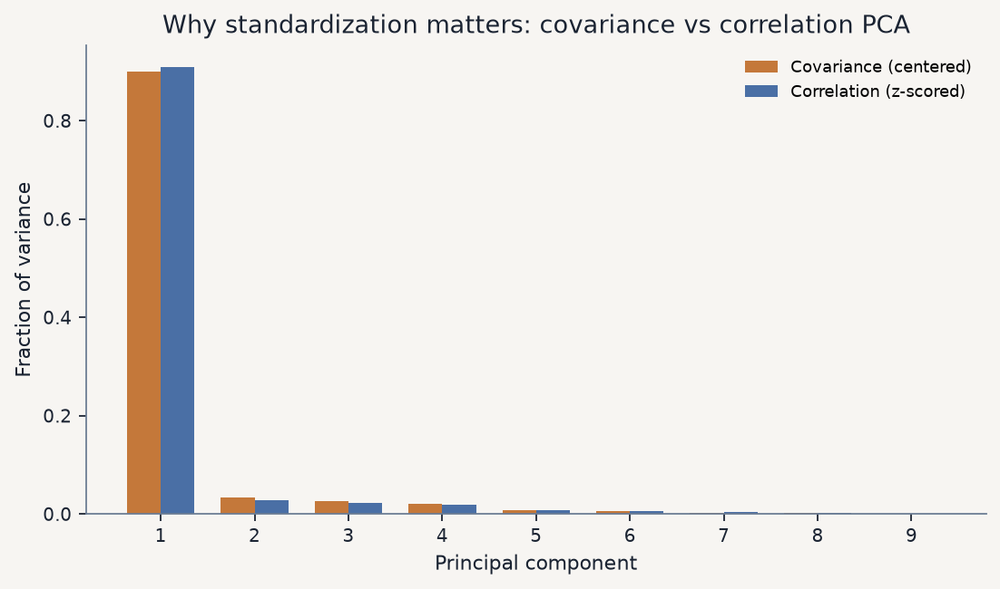

*Figure 3. Explained-variance ratios for centered-only (covariance) PCA versus
z-scored (correlation) PCA. Standardization equalizes gauge scales so that
the spectrum reflects physical coupling rather than metrology dynamic range.*

### Covariance eigenproblem

With $X \in \mathbb{R}^{n \times 9}$ the standardized data matrix, the
unbiased sample covariance is

$$C = \frac{1}{n-1}\, X^{\mathsf{T}} X.$$

The principal modes are the solutions of the symmetric eigenproblem

$$C\, v_k = \lambda_k\, v_k, \qquad \lambda_1 \ge \lambda_2 \ge \cdots \ge \lambda_9 \ge 0,$$

where $v_k \in \mathbb{R}^{9}$ are orthonormal **loadings** and $\lambda_k$
are the variances along those directions. The explained-variance fraction of
component $k$ is

$$\rho_k = \frac{\lambda_k}{\sum_{m=1}^{9} \lambda_m}.$$

Scores and truncated reconstructions follow as

$$T = X V_r, \qquad \hat{X} = T V_r^{\mathsf{T}} = X V_r V_r^{\mathsf{T}}, \qquad V_r = [v_1\,\cdots\,v_r].$$

Equivalently, the thin SVD of the scaled matrix $X / \sqrt{n-1}$ yields the
same loadings as right singular vectors and the same eigenvalues as squared
singular values; the pipeline cross-checks both routes.

A fuller derivation is collected in [`docs/methodology.md`](docs/methodology.md).

## Eigenvalue spectrum, uncertainty, and noise floor

Diagonalizing $C$ yields a steeply decaying spectrum: the first eigenvalue
alone accounts for approximately **90.8%** of the total standardized variance;
the first two together reach **93.7%**. Under a pure-noise null with unit
population variances, the Marchenko–Pastur law confines bulk eigenvalues to
$[(1-\sqrt{\gamma})^{2},\,(1+\sqrt{\gamma})^{2}]$ with $\gamma = p/n$.
Components whose $\lambda_k$ sit above the upper edge $\lambda_{+}$ are
candidates for signal.

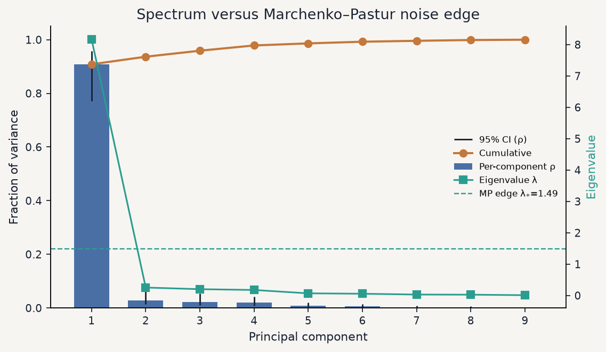

*Figure 4. Eigenvalue spectrum with bootstrap intervals on $\rho_k$ and the
MP upper edge on the eigenvalue axis. Only PC1 clearly exceeds the noise
bulk; PC2 sits near the edge and is retained as a weak but structured
spatial contrast. The cumulative curve crosses 90% already at PC1.*

## Leading thickness modes as a process signal

Projecting every section onto $(v_1, v_2)$ collapses the nine-dimensional
metrology vector onto a plane that retains most of the signal:

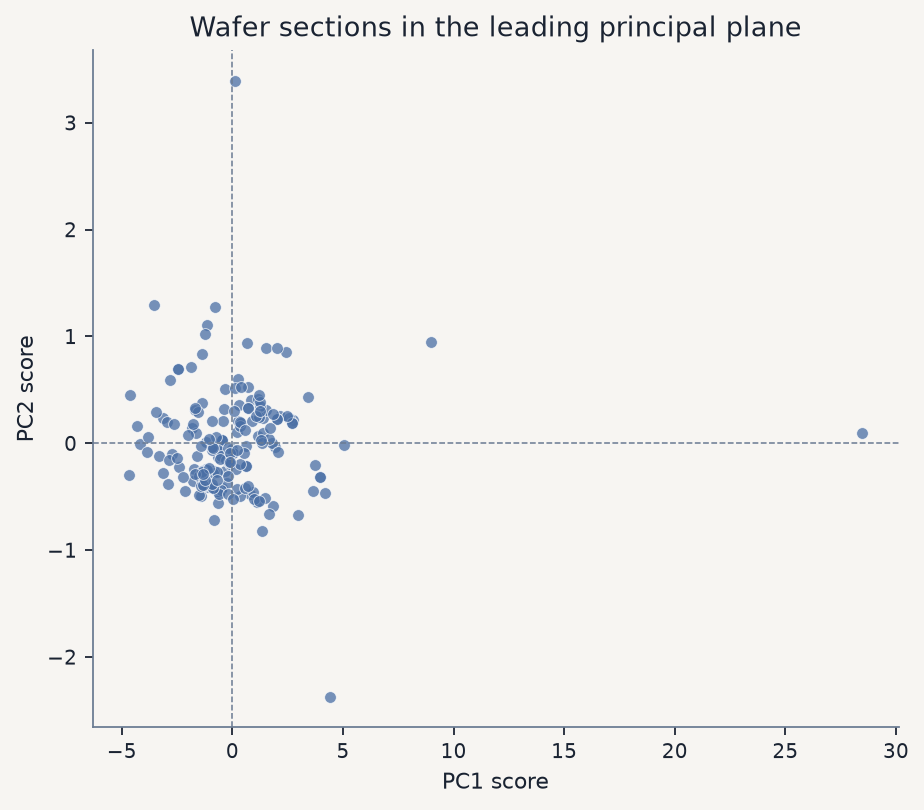

*Figure 5. Scores of the 184 wafer sections in the leading principal plane.
Spread along PC1 reflects the amplitude of the global thickness offset; the
weaker PC2 axis isolates residual spatial asymmetry.*

Because PC1 is a nearly uniform average of all gauges, its score is a natural
**global thickness SPC signal**. A Shewhart chart with center line and
$\pm 3\sigma$ limits turns the mode into an actionable process monitor:

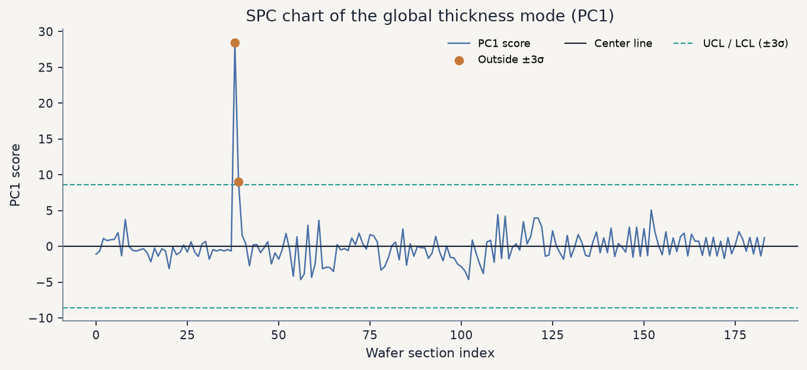

*Figure 6. Control chart of the PC1 score versus section index. Points outside
the $\pm 3\sigma$ limits are global thickness excursions — the same spikes
visible in Figure 1, now compressed into a single monitored statistic.*

## Loadings, spatial structure, and sensor design

The loadings identify the physical character of each mode:

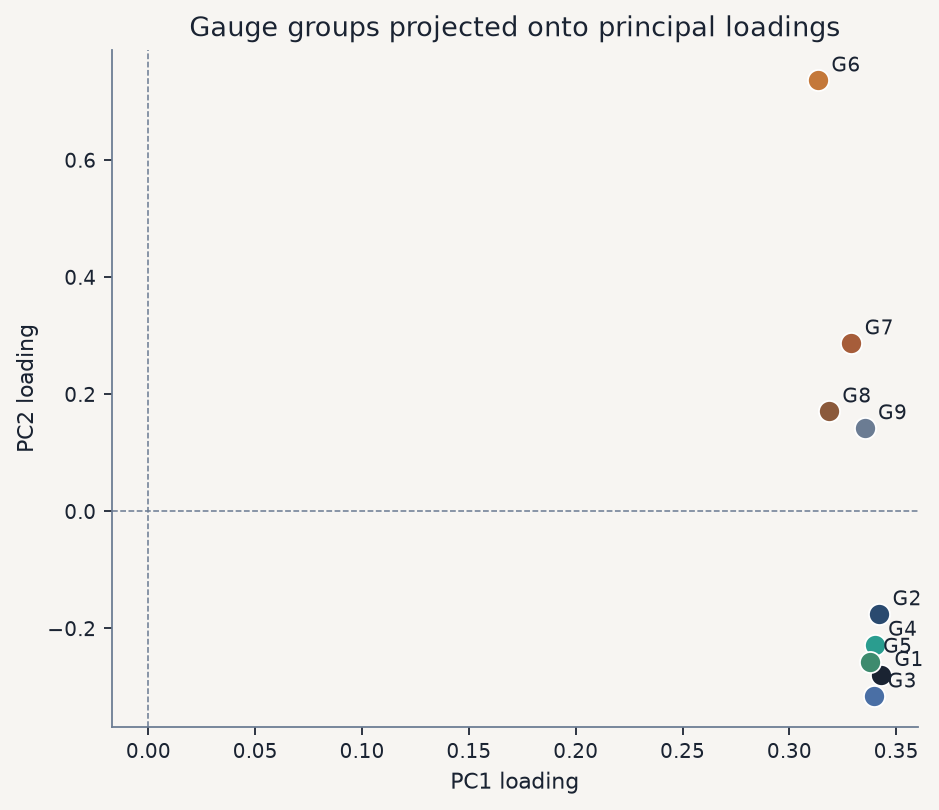

*Figure 7. Gauge groups as points in loading space. Sensors that sit close
together weight the retained modes similarly and are therefore
metrologically redundant for those modes.*

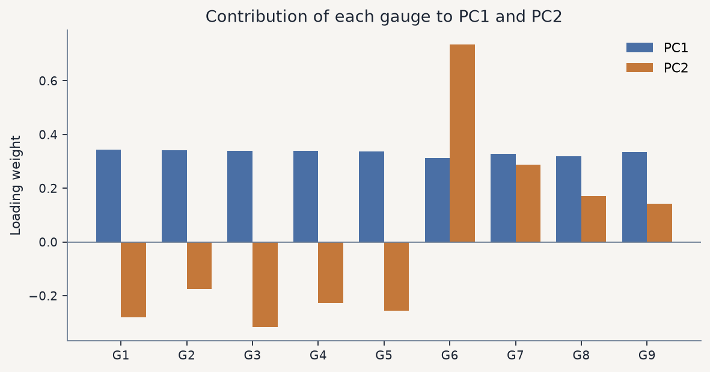

*Figure 8. Loading weights by gauge. PC1 loadings are uniformly positive and
nearly equal ($\approx 0.34$), identifying a **global thickness offset**.
PC2 flips sign: gauges $G_1,\ldots,G_5$ enter with negative weight while $G_6$
dominates positively, identifying a **spatial contrast / gradient mode**.*

Bootstrap resampling of wafer sections supplies 95% intervals on each loading
entry, so the mode geometry is not a point estimate alone:

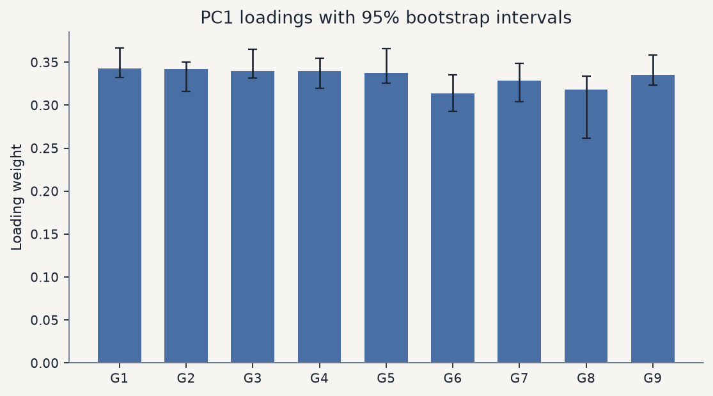

*Figure 9. PC1 loadings with 95% bootstrap intervals. All gauges remain
positive with tight, overlapping intervals — the global-offset reading is
stable.*

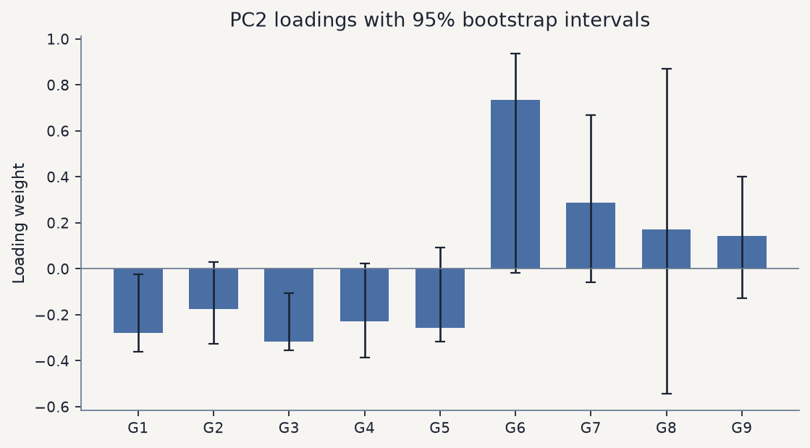

*Figure 10. PC2 loadings with 95% bootstrap intervals. The large positive
weight on $G_6$ is resolved away from zero; the opposing $G_1,\ldots,G_5$ block
is likewise stable, confirming a genuine spatial contrast rather than sampling
noise.*

Exact gauge coordinates were not shipped with the table, so the loadings are
mapped onto a conventional schematic $3\times 3$ grid (row-major $G_1,\ldots,G_9$)
for interpretation only:

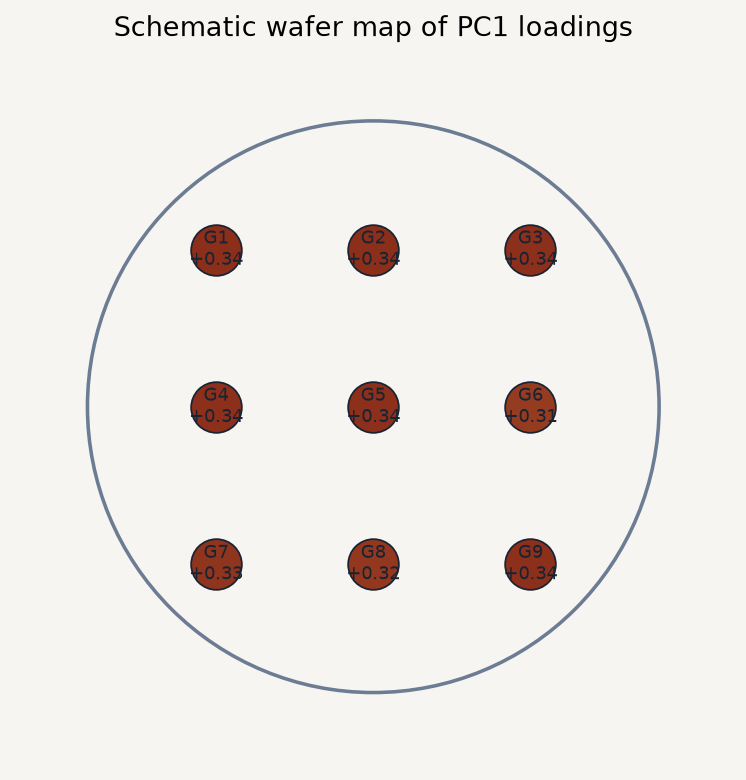

*Figure 11. Schematic wafer disk colored by PC1 loadings. Uniform sign and
comparable magnitude at every gauge recover the global offset mode.*

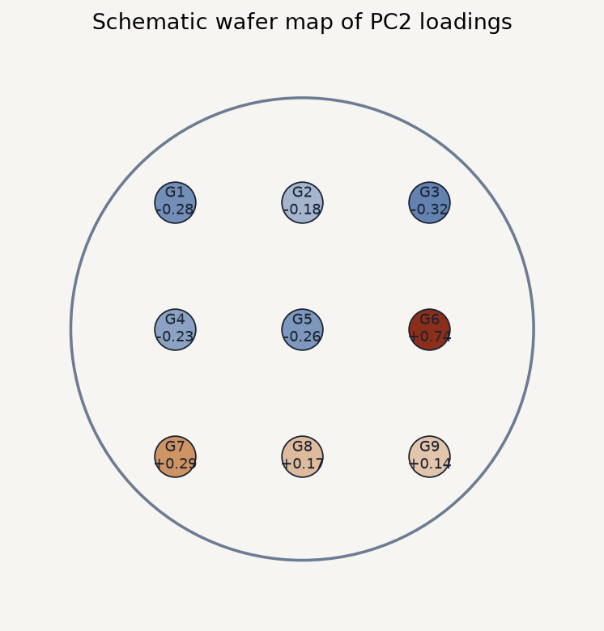

*Figure 12. Same layout colored by PC2. The east-side gauge $G_6$ dominates
the contrast, while $G_1,\ldots,G_5$ oppose it — a spatial gradient / bow pattern
rather than another global offset.*

The closest pair in the PC1–PC2 loading plane is **G1–G5**. Dropping the
redundant gauge ($G_5$), the contrast driver ($G_6$), or both, and re-fitting
PCA, turns that observation into a metrology-design experiment:

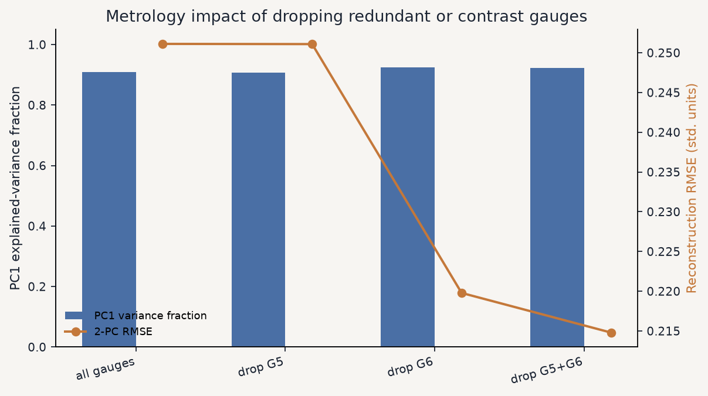

*Figure 13. PC1 variance fraction and two-component reconstruction RMSE after
gauge pruning (RMSE evaluated on the gauges that remain). Dropping $G_5$
barely moves either metric — true redundancy with $G_1$. Dropping $G_6$
*increases* $\rho_1$ and *lowers* RMSE on the remaining sensors because the
spatial-contrast degree of freedom has been removed from the problem; the
cost is loss of sensitivity to that bow/gradient mode, not a worse fit of
the global offset.*

## Outliers and robustness

Several sections in Figure 1 reach deviations of order 7–8 while typical
values sit near $0.2$. A Mahalanobis gate on the standardized rows flags these
heavy tails; median/MAD scaling and a filtered re-fit test whether the
spectrum depends on them.

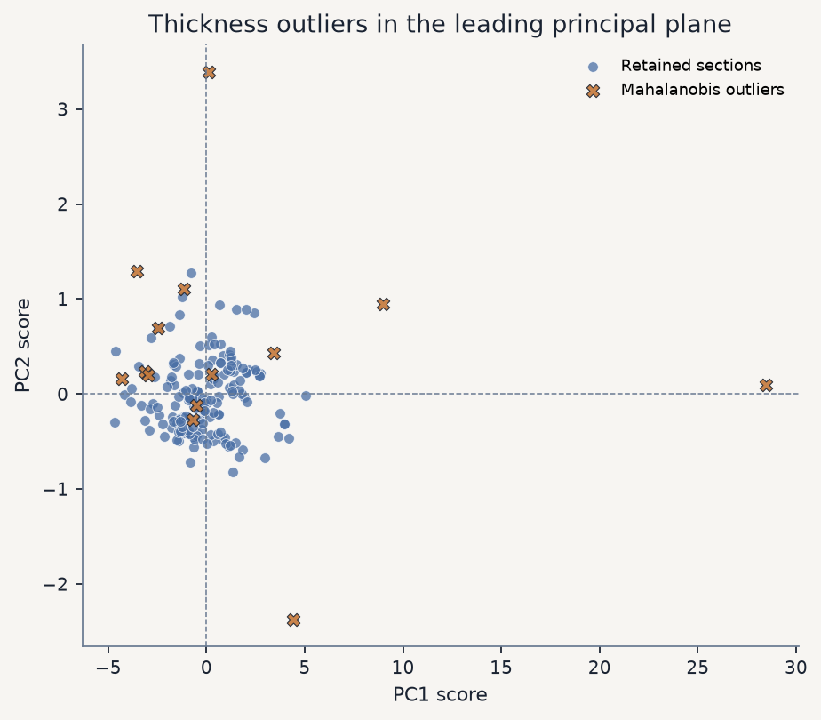

*Figure 14. Outlying sections (crosses) lie far along the PC1 axis — extreme
global thickness offsets rather than a separate geometric family.*

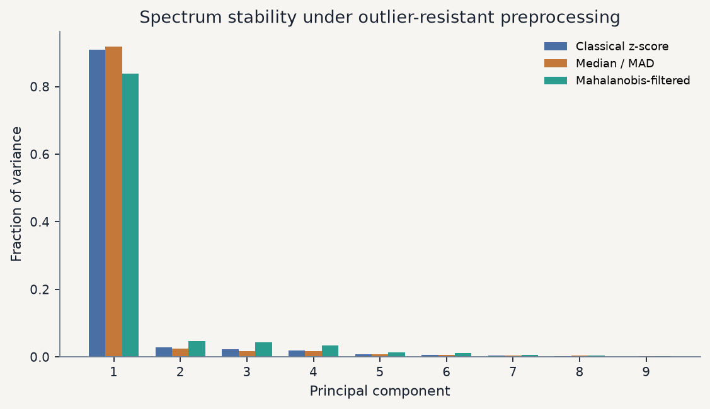

*Figure 15. Explained-variance ratios under classical z-scores, median/MAD
scaling, and Mahalanobis filtering. PC1 remains overwhelmingly dominant in
all three treatments, so the one-to-two-mode picture is not an artifact of
the spikes.*

## Reconstruction fidelity

Truncating to $r = 2$ components recovers the standardized thickness field to
an RMSE of about $0.25$. Side-by-side panels for a typical section, a large
PC1 excursion, and a large $|\mathrm{PC2}|$ section make that error spatially
concrete:

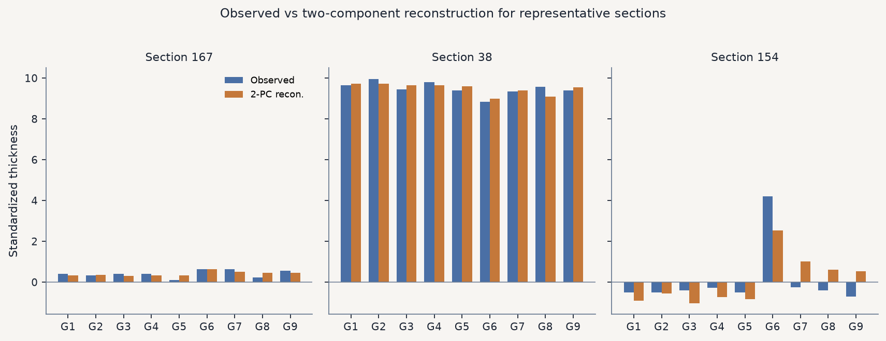

*Figure 16. Observed versus two-component reconstruction for representative
sections. The global envelope is recovered everywhere; residuals concentrate
on the finer gauge-to-gauge contrast that lives in PC3 and beyond.*

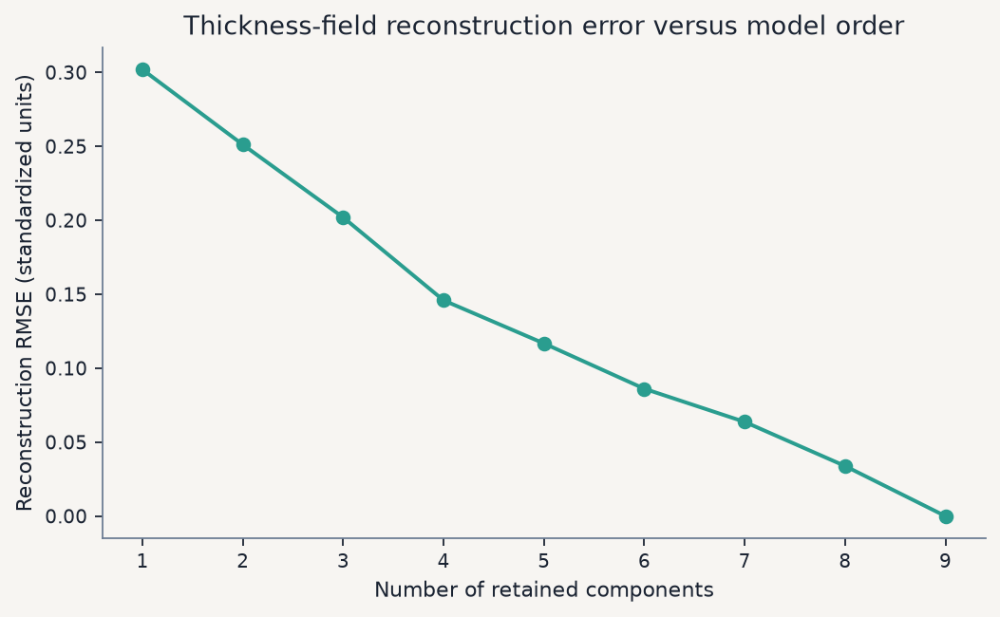

*Figure 17. Reconstruction error versus model order. The steep initial drop
mirrors the scree plot: once the global offset (PC1) and the leading spatial
contrast (PC2) are kept, additional components buy only marginal fidelity.*

Where the two-component model still fails is spatially localized:

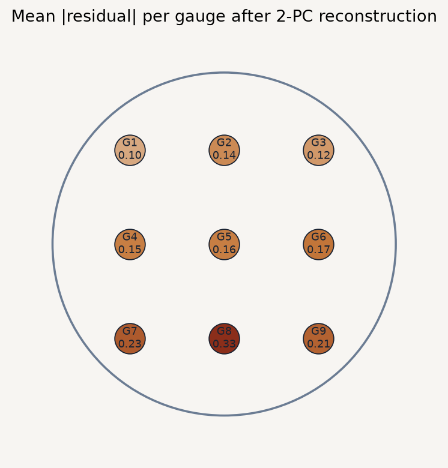

*Figure 18. Mean absolute residual per gauge after the 2-PC fit. Residuals
are small everywhere and slightly elevated where higher-order contrast lives
— consistent with a field that is already well described by offset + tilt.*

Out-of-sample error tracks the in-sample curve, so the low RMSE is not an
in-sample artifact:

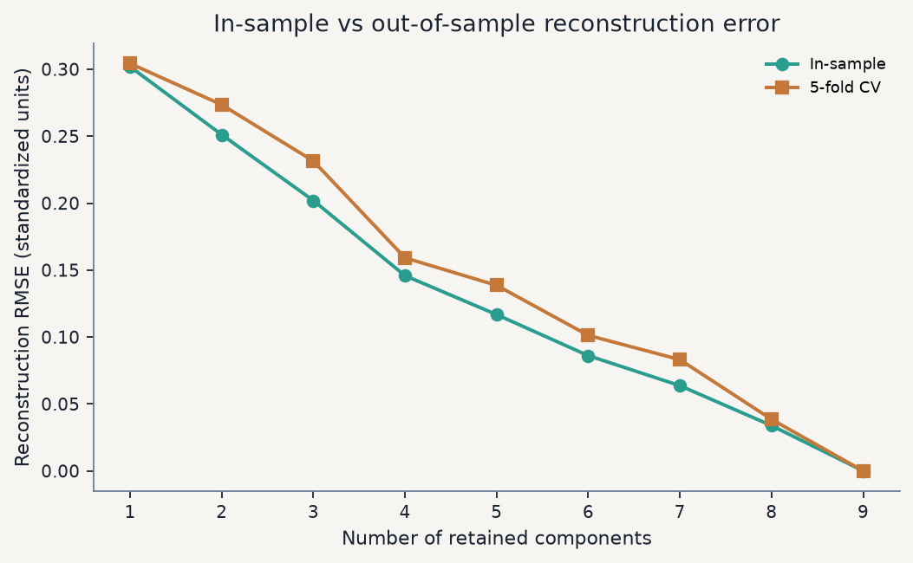

*Figure 19. In-sample versus 5-fold cross-validated reconstruction RMSE.
The curves nearly coincide: loadings estimated on training sections
generalize to held-out wafer sections.*

## Physical plane model and PC2 significance

A minimal physical model — per-section **global offset + linear tilt** on the
schematic $(x,y)$ gauge layout — is fit by least squares and compared to PCA:

$$x_{ij} \approx a_i + b_i\, x_j + c_i\, y_j.$$

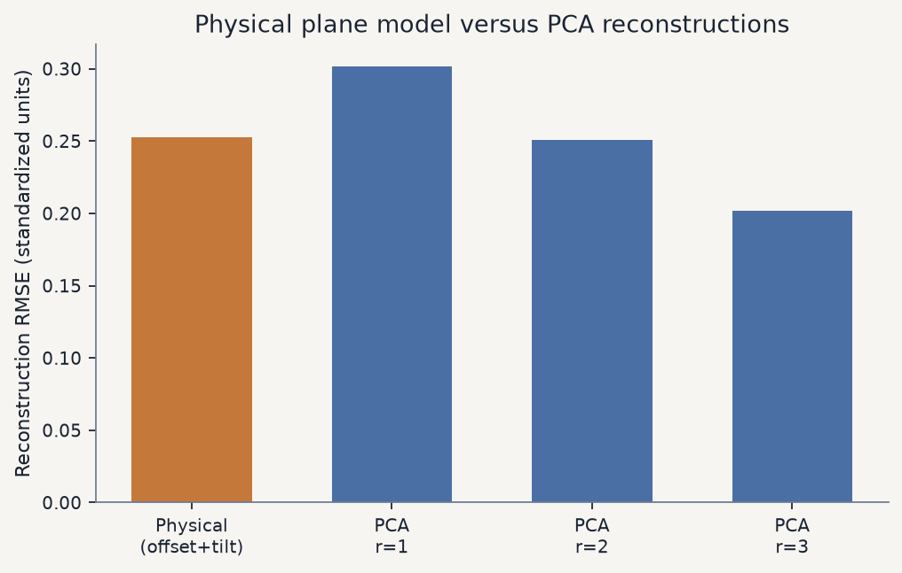

*Figure 20. Reconstruction RMSE of the physical plane model versus PCA with
$r = 1,2,3$. The plane model lands close to two-component PCA: the leading
eigenmodes are essentially the same geometric degrees of freedom a process
engineer would write down by hand.*

A column-shuffle permutation test asks whether the observed $\rho_1$ exceeds
what independent gauges would produce; a second test permutes gauge *labels*
and asks whether the PC2 loading pattern is spatially organized on the
schematic wafer:

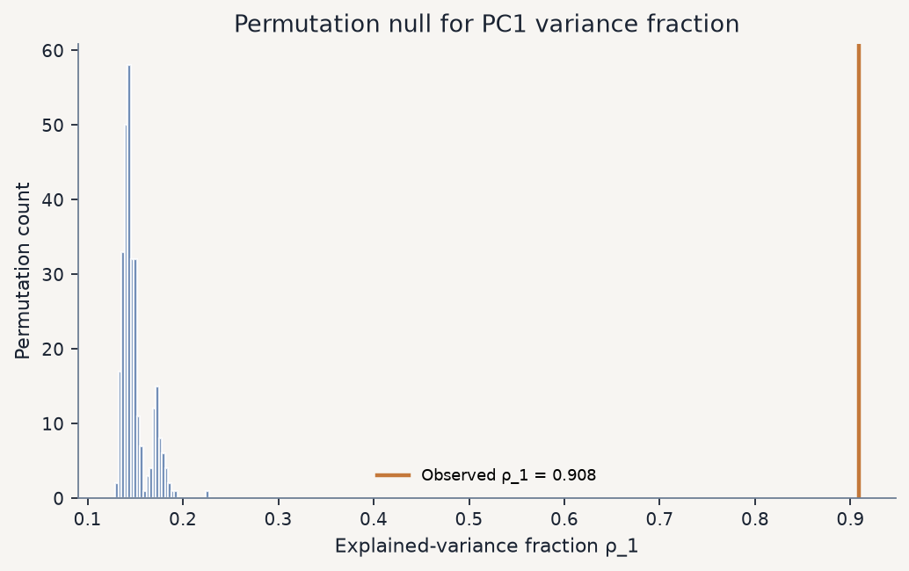

*Figure 21. Null histogram of $\rho_1$ under column permutations. The observed
global-mode fraction lies far above the null — the common-mode thickness
offset is not a chance fluctuation of nine independent sensors.*

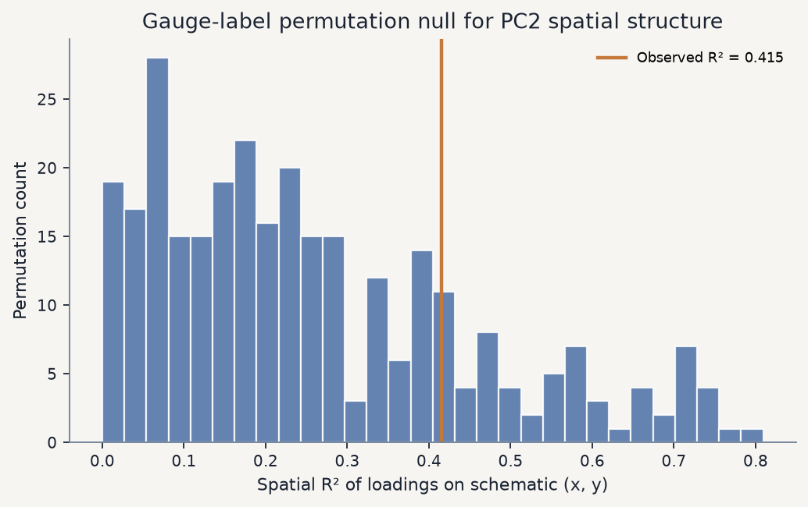

*Figure 22. Null histogram of the spatial $R^{2}$ of PC2 loadings against
schematic $(x,y)$ under random gauge-label permutations. The observed
$R^{2} \approx 0.42$ is moderate; with only nine schematic sites the
permutation p-value is not decisive on its own. The stronger geometric
evidence is Figure 20: a literal offset+tilt model matches two-component
PCA almost exactly.*

## Repository layout

```
data/                     thickness table + provenance note
src/wafer_pca/            reusable analysis package
  data.py                 loading, z-score / MAD scaling, outlier mask
  pca.py                  covariance PCA, SVD cross-check, bootstrap CIs
  diagnostics.py          MP edge, pruning, SPC, CV, physical plane, permutations
  exploration.py          correlation and reconstruction diagnostics
  plotting.py             figure generation for the workflow above
  __main__.py             CLI: python3 -m wafer_pca
scripts/run_analysis.py   convenience wrapper → figures/
docs/methodology.md       extended mathematical notes
docs/github_about.md      suggested GitHub About text and topics
tests/                    invariants of standardization, PCA, SVD, diagnostics
figures/                  plots embedded in this README
```

## Running the analysis

```bash
python3 -m venv .venv
source .venv/bin/activate
pip install -r requirements.txt
pip install -e .

python3 -m wafer_pca --figures figures
python3 -m pytest
```

Options: `--data PATH`, `--bootstrap N`, `--seed INT`. The pipeline
regenerates every figure under `figures/` and writes
`figures/analysis_summary.json`.

## Key quantitative results

| Quantity | Value |
| --- | --- |
| Sections $\times$ gauges | $184 \times 9$ |
| Variance in PC1 | $90.8\%$ (bootstrap 95% CI $[77.7\%,\, 95.7\%]$) |
| Variance in PC1 + PC2 | $93.7\%$ |
| MP signal components ($\lambda_k > \lambda_{+}$) | PC1 (PC2 near the edge) |
| Mahalanobis outliers | $14$ of $184$ sections |
| Closest gauges (loading plane) | G1–G5 |
| Dropping G5 | PC1 / RMSE essentially unchanged (redundant) |
| Dropping G6 | PC1 rises; RMSE on remaining gauges falls (contrast mode removed) |
| RMSE with $r = 2$ components | $0.25$ (standardized units) |
| 5-fold CV RMSE ($r = 2$) | matches in-sample within noise |
| Physical plane RMSE | comparable to 2-PC PCA |
| PC1 permutation p-value | $\ll 0.05$ (common mode) |
| PC2 spatial $R^{2}$ (schematic) | $\approx 0.42$ (moderate; tilt reading rests mainly on Fig. 20) |
| Covariance PCA vs SVD | eigenvalues agree |

In short: silicon wafer thickness, as seen by nine correlated gauges, is
essentially a **one-to-two-mode geometric field**. The first principal
component is a global offset — and a practical SPC statistic — shared by every
sensor; the second encodes the leading spatial gradient, dominated by $G_6$,
and matches the tilt degree of freedom of a simple physical plane model.
Higher components refine the reconstruction but do not change the physical
picture, and the spectrum survives outlier-resistant reprocessing, gauge
pruning of the redundant sensor $G_5$, cross-validation, and permutation
tests for both the common mode and the spatial structure of PC2.
